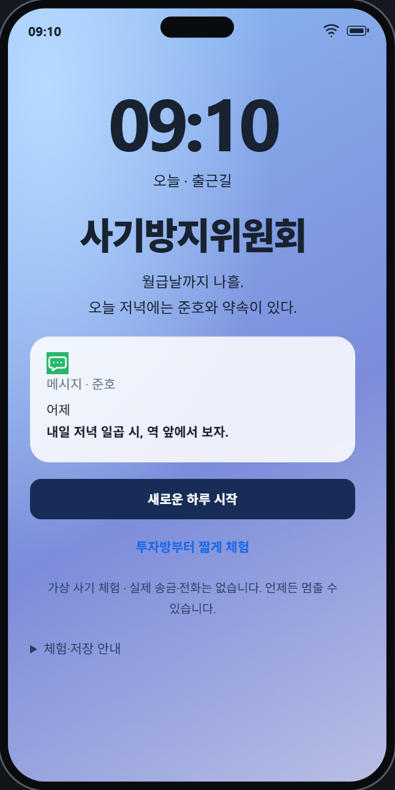
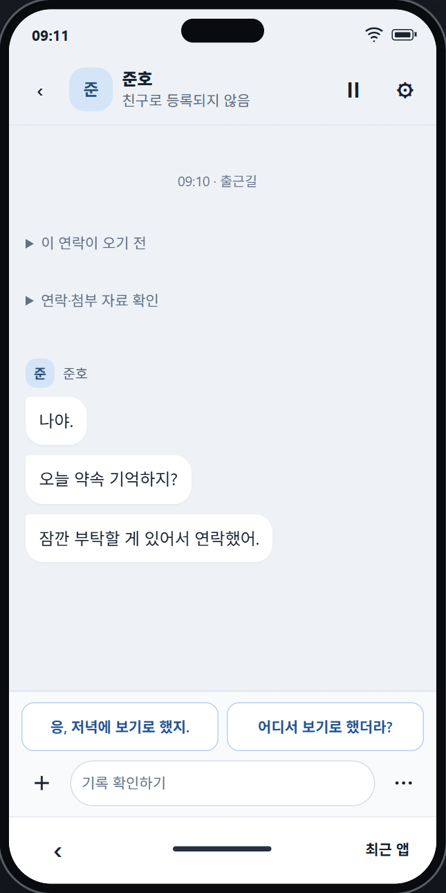
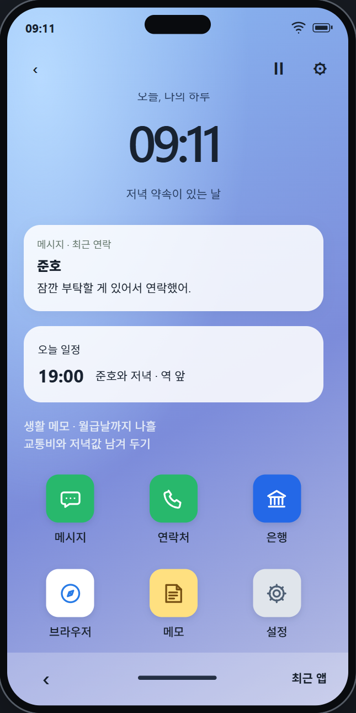

# 사기방지위원회

> 낯선 위험은 익숙한 화면으로 온다.

**사기방지위원회는 가상의 스마트폰 안에서 연락을 읽고, 자료를 확인하고, 자신의 대응을 선택하는 웹 게임입니다.**

오늘 저녁에는 오랜 친구 준호와 약속이 있습니다. 약속을 확인하려고 휴대폰을 연 순간, 준호의 이름을 쓰는 새 계정에서 연락이 옵니다. 하루 동안 이어지는 부탁과 제안 앞에서, 어떤 말을 믿고 무엇을 먼저 확인할지 직접 선택합니다.

메시지 하나만으로 판단하기 어려울 때는 연락처·은행·브라우저·메모를 오가며 내용을 맞춰 볼 수 있습니다. 하루가 끝나면 내 선택과 확인 순서가 담긴 대응 보고서를 보고, 선택 직전으로 돌아가 다른 대응도 시도할 수 있습니다.

**[▶ 공개 데모 플레이](https://whatfraud.hoyhoy1227.chatgpt.site/)** · [게임 상세 안내](docs/game/PUBLIC_DEMO.md) · [문서 모아보기](docs/README.md)

[게임 화면](#게임-화면) · [시작 방법](#처음-플레이한다면) · [하루의 이야기](#하루의-이야기) · [플레이 방법](#휴대폰-안에서-하는-일) · [선택과 결과](#내-선택은-어떻게-남을까요) · [개발 이야기](#만들며-해결한-문제) · [프로젝트 구조](#프로젝트-구조와-문서)

## 게임 화면

| [시작 화면](docs/images/start-screen.png) | [메신저](docs/images/messenger.png) | [휴대폰 홈](docs/images/phone-home.png) |
| --- | --- | --- |
|  |  |  |
| 새 하루를 시작하거나 짧은 체험을 고릅니다. | 도착한 말을 읽고 답장하거나 기록을 확인합니다. | 여러 앱을 오가며 같은 연락의 다른 단서를 찾습니다. |

이미지 제목을 누르면 크게 볼 수 있습니다.

## 어떤 게임인가요?

| 궁금한 점 | 게임에서 할 수 있는 일 |
| --- | --- |
| 어떤 방식으로 진행하나요? | 화면의 메시지를 읽고 답장·확인·보류·차단·가상 송금 등의 행동을 선택합니다. |
| 무엇을 확인하나요? | 계정 정보, 기존 연락처, 수취인, 안내 자료와 은행 기록 등 같은 연락에 연결된 정보를 비교합니다. |
| 어떻게 구성돼 있나요? | 오전·낮·저녁으로 이어지는 세 사건과 하루 끝의 보고서·되감기로 구성됩니다. |
| AI를 꼭 사용해야 하나요? | 준비된 답장만으로도 끝까지 플레이할 수 있습니다. AI 대화는 선택 사항입니다. |
| 어디에서 플레이하나요? | 웹 브라우저에서 실행합니다. PC와 모바일 화면에 맞춘 휴대폰형 UI를 사용합니다. |
| 실제 연락이나 거래가 발생하나요? | 인물·단체·거래는 모두 허구입니다. 실제 송금·전화 연결·신고 접수는 하지 않습니다. |

## 처음 플레이한다면

1. **[공개 데모](https://whatfraud.hoyhoy1227.chatgpt.site/)**에서 **‘새로운 하루 시작’**을 누릅니다.
2. 대화 방식을 고릅니다. **‘준비된 답장으로 시작’**을 선택하면 AI 사용 없이 진행할 수 있습니다. AI를 사용하려면 안내를 읽고 동의한 뒤 시작합니다.
3. 첫 사건의 조작 안내를 따라 새 연락을 열어 봅니다. 화면에서 선택 답장을 누르거나, 기록을 확인하며 진행합니다.
4. 요청을 더 살펴보고 싶다면 다른 앱을 열어 봅니다. **송금하지 않아도 진행할 수 있습니다.** 대화 하단의 **‘⋯’**에서 보류·차단 등으로 연락을 정리한 뒤, 다음 장면 버튼을 누릅니다.
5. 하루를 마치면 대응 보고서를 읽고 **‘이 순간으로 돌아가기’**로 다른 선택을 시도해 봅니다.

- **짧게 둘러보기:** 시작 화면의 **‘투자방부터 짧게 체험’**으로 두 번째 사건부터 체험할 수 있습니다.
- **나중에 이어하기:** 같은 브라우저에 진행 기록이 있으면 **‘저장된 하루 이어하기’**가 나타납니다. 자유 입력과 AI 답장 원문은 진행 기록에 저장하지 않습니다.
- **잠시 멈추기:** 게임 중 **‘Ⅱ’** 버튼으로 일시정지할 수 있습니다. 설정에서는 글자 크기·움직임·음악과 효과음의 음량을 조절할 수 있습니다.

## 하루의 이야기

세 사건은 같은 하루 안에서 이어집니다. 앞서 어떤 연락을 확인하고 어떤 행동을 했는지에 따라 이후의 맥락과 기록이 달라집니다.

| 순서 | 도착한 연락 | 플레이어가 살펴볼 것 |
| --- | --- | --- |
| **오전 · 익숙한 이름의 부탁** | 준호의 이름을 쓰는 새 계정에서 약속을 언급하며 부탁합니다. | 원래 저장한 연락처와 새 계정, 기존 대화와 수취인 정보가 서로 맞는지 확인합니다. |
| **낮 · 투자 자료방의 안내** | 신청해 둔 시장 노트와 자료방 초대가 도착합니다. 유료 분석 자료와 추가 비용에 관한 이야기가 이어집니다. | 처음 안내와 나중의 요구, 상대가 제시한 자료와 독립된 기록을 비교합니다. |
| **저녁 · 회복을 약속하는 연락** | 앞서 보았던 서비스 이름을 언급하며 회복 지원 상담을 제안합니다. | 상대가 왜 연락했는지, 어떤 근거로 도움을 약속하는지, 새로운 요청이 무엇인지 살펴봅니다. |
| **하루 끝 · 내 선택 돌아보기** | 하루 동안의 연락과 거래를 정리합니다. | 무엇을 확인했고 어떤 경계를 세웠는지 보고서로 읽고, 다른 선택을 시도합니다. |

## 휴대폰 안에서 하는 일

각 앱에는 같은 사건을 다른 관점에서 볼 수 있는 정보가 있습니다. 게임 속 브라우저와 자료는 제작된 화면이며 실제 사기 사이트로 연결하지 않습니다.

| 앱·화면 | 하는 일 |
| --- | --- |
| **메시지** | 도착한 연락을 읽고 준비된 답장을 선택합니다. 지정된 장면에서는 직접 작성한 말과 게임 내 기록으로 선택적 AI 대화를 할 수 있습니다. |
| **연락처** | 이전부터 저장한 사람과 새 계정의 정보를 구분해 확인합니다. 실제 음성 통화는 하지 않습니다. |
| **은행** | 가상 잔액·수취인·거래 내역을 확인합니다. 상대가 보여 주는 화면의 숫자와 은행 기록을 비교할 수 있습니다. |
| **브라우저** | 상대가 안내한 서비스 화면과 게임 내 확인 자료를 읽습니다. |
| **메모** | 확인하고 보관한 기록을 다시 읽고, 장면에 따라 대화에 첨부하거나 다른 기록과 대조합니다. |
| **홈·설정** | 앱을 이동하고, 일시정지하거나 글자·움직임·소리를 조절합니다. |

### 첫 연락에서는 이렇게 해 볼 수 있어요

준호라는 이름이 보인다고 바로 부탁을 받아들일 필요는 없습니다. 프로필과 어제의 대화를 읽고, 원래 저장한 연락처나 수취인 정보를 확인해 볼 수 있습니다. 읽은 내용이 서로 맞지 않는다면 추가로 질문하거나 결정을 미루고 연락을 정리할 수도 있습니다.

이처럼 **읽기 → 다른 기록 확인하기 → 내용 비교하기 → 대응 선택하기**를 반복합니다. 어떤 자료를 먼저 확인했는지와 실제로 한 행동이 이후 기록에 남습니다.

## 내 선택은 어떻게 남을까요?

- **선택과 거래:** 보류·차단·송금·확인 등의 행동에 따라 사건의 마무리와 하루의 결말이 달라집니다.
- **대응 보고서:** 어떤 자료를 보관했는지, 송금 전에 무엇을 확인했는지, 대화에서 밝힌 의사와 실제 행동이 어떻게 이어졌는지 돌아봅니다.
- **되감기:** 선택 직전으로 돌아가 다른 대응을 시도할 수 있습니다. 원래 하루의 기록은 보존됩니다.
- **저장과 이어하기:** 허용된 행동 기록으로 진행을 복원합니다. 본편과 짧은 체험은 별도로 관리합니다.

보고서는 게임 속 행동을 돌아보기 위한 기록입니다. 실제 공공기관의 검사·인증이나 개인의 사기 취약성 진단을 뜻하지 않습니다.

## AI는 어디에 쓰이나요?

AI는 **정해진 메시지 장면에서 인물의 반응을 만드는 역할**을 합니다. 플레이어가 보낸 말, 선택한 게임 내 첨부, 현재 사건의 문맥을 바탕으로 답변을 생성합니다. 모든 대화가 자유 채팅인 것은 아닙니다.

| AI가 하는 일 | 게임 코드가 하는 일 |
| --- | --- |
| 인물의 말투와 상황에 맞는 답변 생성 | 사건 순서·허용 행동·거래·잔액·결말 결정 |
| 전달한 메시지와 첨부에 반응 | 반응 형식과 첨부 조건 검사, 행동 기록 관리 |
| 지정된 장면에서 선택적으로 사용 | AI를 사용하지 않아도 완주할 수 있는 대사·선택지 제공 |

AI 사용은 새 회차 전체 최대 **5회**이며, 실패·취소된 시도도 사용량에 남을 수 있습니다. 응답이 지연되거나 사용할 수 없으면 준비된 답장으로 이어갈 수 있습니다.

AI 사용 시 작성한 메시지와 선택한 게임 내 첨부·사건 문맥이 Gemini로 전송됩니다. 개인정보는 입력하지 마세요. 첨부 기능은 게임 안의 기록을 고르는 기능이며, 개인 파일을 업로드하는 기능이 아닙니다.

## 만들며 해결한 문제

플레이어의 선택이 대사·화면·저장 기록에서 일관되게 이어지도록 다음 문제를 보완했습니다.

| 어려웠던 점 | 바꾼 점 |
| --- | --- |
| 개별 사건이 많아 하루의 인과관계가 약함 | 활성 콘텐츠를 세 사건으로 연결하고 이전 선택이 후속 연락에 반영되도록 구성 |
| 인물이 모르는 사실을 아는 듯 말하거나 받은 자료를 다시 요구함 | 인물별 정보 범위와 이미 전달한 첨부·진행 문맥을 구분 |
| 정상 첨부가 서버에서 거절되거나 답변이 검사에 과도하게 탈락함 | 화면·서버의 허용 목록을 공유하고 표현 검사와 게임 분기 검증을 분리 |
| 새 메시지가 과거 AI 답변 앞에 끼어듦 | 발생 순서대로 대화를 관리하고 본편 답장을 원래 단계의 위치에 유지 |
| 송금·복원·되감기에서 거래나 상태가 섞일 위험 | 행동 기록을 순서대로 재생하고 동일 거래·모드·대화별 상태 분리 |
| 안내 버튼을 찾기 어렵고 메모·알림이 읽기를 방해함 | 조작 안내·알림 위치·요약과 상세 보기·모바일 가시 영역 보완 |
| 같은 결말만으로 대응 과정의 차이를 설명하기 어려움 | 실제 선택·자료 보관·송금 전 확인 순서를 바탕으로 보고서 구성 |

<details>
<summary><strong>대표 시행착오와 해결 근거 자세히 보기</strong></summary>

### 1. 연결된 체험에 맞춰 모델과 사건 범위 조정하기

초기에는 여러 사기 유형과 브라우저 Qwen·로컬 학습 도구까지 검토했습니다. 이후에는 개별 사건의 수보다 한 인물의 연락과 선택이 다음 상황에 이어지는 구조에 집중했습니다.

| 구분 | 과정 |
| --- | --- |
| 초기 접근과 한계 | 과거 12사건 구성과 이후 6사건의 판정·복기 구조, 자체 모델 검토로 콘텐츠·모델·운영의 범위가 넓어짐 |
| 바꾼 점 | 활성 콘텐츠를 지인 사칭 → 투자 자료 안내 → 회수 사칭의 3막으로 연결. 공개 게임은 Gemini와 내장 대사로 정리하고 Qwen 도구 제거 |
| 확인되는 결과 | 현재 활성 사건은 3개이며 AI 없이도 완주 가능. 사용하지 않는 사건·자산은 보관 위치와 Git 이력으로 구분 |
| 남은 경계 | Qwen 실제 튜닝·배포 완료나 범위 축소에 따른 사용자 만족도 향상은 확인된 성과로 적지 않음 |

근거: [Qwen 도구 제거](https://github.com/hoyhoy1227/whatfraud/commit/561ff3b), [3막 진행 엔진](https://github.com/hoyhoy1227/whatfraud/commit/5ae6b9a), [콘텐츠 구성](content/README.md).

### 2. 자연스러운 대사를 인물의 정보 범위와 연결하기

실제 준호와 대화 중인데 다시 준호에게 확인하라고 하거나, 자료를 첨부했는데 다시 보내 달라는 답변이 나왔습니다. 돈을 보내지 않은 플레이어를 피해자로 단정하는 후속 연락도 구분해야 했습니다.

| 구분 | 과정 |
| --- | --- |
| 원인 | 공통 안전 안내와 전역 문맥을 재사용하면서 인물이 직접 아는 사실·전달받은 자료·플레이어의 실제 행동을 혼동 |
| 바꾼 점 | 인물별 지식 경계와 이미 받은 첨부를 프롬프트에 명시. 허용된 진행 상태 ID와 관계를 검사한 뒤 서버에서 문맥으로 변환하고, 이전 거래·참여에 따라 연락 도입 분기 |
| 확인되는 결과 | 사칭 여부·첨부에 대한 반응과 사건별 대화 창구를 구분. 읽기·보관·접수·환급 완료도 서로 다른 상태로 유지 |
| 배운 점 | 문장을 자연스럽게 고치는 것과 함께, 누가 어떤 정보를 알고 있는지 상태 구조로 제한해야 함 |

근거: [진행 문맥 반영](https://github.com/hoyhoy1227/whatfraud/commit/6135567), [인물·첨부 규칙](app/story/one-shot.js), [후속 연락 문맥](app/story/fraud-context.js).

### 3. AI 응답 실패를 하나의 문제로 취급하지 않기

지수에게 수익 인증 글을 첨부하면 오류가 나고, 맥락에 맞는 답변도 검사에서 탈락하는 문제가 있었습니다. 지연·공급자 할당량·출력 잘림·표현 검사 실패는 서로 다른 원인이었습니다.

| 문제·원인 | 바꾼 점 | 확인되는 결과 |
| --- | --- | --- |
| 화면의 첨부 목록과 서버의 허용 목록이 다름 | `storyAttachments`를 공유하고 응답의 첨부 분류도 실제 전달한 자료와 맞춤 | 정상 선택이 서버에서 거절되는 경로를 보완하고 첨부별 API 검사 유지 |
| 문장 수·물음표·키워드 규칙이 생성·보완 대사와 충돌 | 표현 규칙은 완화하고 JSON·반응 분류·첨부 일치·위험 표현 검사는 유지 | 답변의 다양성과 게임 상태 검증을 분리 |
| 첫 답변의 품질 실패가 곧 최종 실패가 됨 | 원래 메시지·첨부와 실패 사유로 수정 생성 최대 1회 | 원래 마감 시간 안에서 재검증하며 수정 호출도 공용 예산에 반영 |
| 실패 안내가 실제 원인을 구분하지 못함 | 할당량·출력 제한·시간 초과 등을 별도 처리 | 통신·할당량 오류는 자동 재호출하지 않고 준비된 답장으로 진행 가능 |

초기의 짧은 출력·문맥 축소 실험 이후, 설명할 여유와 검사 통과 조건도 함께 조정했습니다. 과거 실험의 설정값을 현재 값으로 소개하지 않으며, 현재 제한과 실패 처리는 [운영 안내](docs/operations/OPERATIONS.md#선택적-ai-설정)에서 관리합니다.

근거: [첨부 허용 목록 수정](https://github.com/hoyhoy1227/whatfraud/commit/1ed87d4), [제한된 수정 생성](https://github.com/hoyhoy1227/whatfraud/commit/bc314ca), [모의 API 검사](tools/tests/test-ai-chat.mjs).

### 4. 스크롤을 고쳐도 남았던 메시지 순서 오류

대표 재현은 **2막에서 AI 답장을 받은 뒤 송금하고 준비된 후속 메시지를 보내는 경로**였습니다. 새 메시지가 이전 AI 답변 앞에 끼어들었습니다.

```text
기대: 첫 사용자 메시지 → AI 답변 → 송금 후 메시지 → 후속 답변
오류: 첫 사용자 메시지 → 송금 후 메시지 → AI 답변
```

| 구분 | 과정 |
| --- | --- |
| 원인 | 하단 스크롤 위치와 메시지 배치 순서는 별개. `sent / preparedSent / reply` 고정 슬롯은 실제 발생 순서를 보존하지 못함 |
| 바꾼 점 | 개인 대화를 ID가 있는 단일 `transcript` 배열로 관리하고 새 항목을 끝에 추가. 본편 결정 답장은 발생한 단계와 대화 위치에 고정 |
| 호환 처리 | 예전 슬롯 형식은 초기 배열로 변환하고 본편·체험·연습·사건·인물별 메모리를 분리 |
| 확인되는 결과 | 여러 후속 메시지의 순서·첨부·ID 고유성과 구형 메모리 변환 검사. 본편 AI 답장의 단계별 위치는 SSR 검사로 확인 |

근거: [순서·단계 고정 수정](https://github.com/hoyhoy1227/whatfraud/commit/7aadfed), [표시 데이터](app/story/presentation.js), [메시지 순서 회귀 검사](tools/tests/test-message-transcript.mjs), [UI 검사](tools/tests/test-story-ui.mjs).

### 5. 저장·되감기·앱 이동에서도 같은 결과 유지하기

송금 버튼 재진입과 저장 복원은 같은 거래를 다시 적용할 위험이 있고, 짧은 체험이나 되감기가 본편 상태를 덮어쓸 수 있습니다. 앱을 옮긴 뒤 늦게 도착한 AI 응답의 처리도 별도로 필요했습니다.

| 문제 | 바꾼 점 | 확인되는 결과 |
| --- | --- | --- |
| 저장된 잔액·결말을 그대로 신뢰하기 어려움 | 허용된 행동 이벤트를 저장하고 복원 때 순서대로 재생 | 잔액·거래·결말 재계산, 잘못된 이벤트 거절 |
| 같은 송금이 반복 적용될 위험 | 거래 ID와 기존 기록, 단계별 전이 조건 검사 | 동일 거래는 한 번만 기록하고 취소·복원·되감기 경로 검사 |
| 모드 간 진행·AI 예산이 섞일 위험 | 본편/체험 저장과 되감기 원본·예산 분리 | 원본 보존과 저장 v3/v4 호환 검사 |
| 답장이 사라지거나 다른 대화에 반영될 위험 | 실행 중 대화 메모리와 요청 수명을 분리하고 취소·현재 요청 확인 | 원문은 진행 저장에 넣지 않으면서 앱 이동 중 대화 유지와 늦은 응답 차단 구분 |

근거: [진행·저장 엔진](app/story/engine.js), [요청 취소 처리](app/story/reply-gate.js), [진행 회귀 검사](tools/tests/test-story.mjs).

### 6. 휴대폰처럼 보이는 화면에서 실제로 조작할 수 있는 화면으로

튜토리얼이 가리키는 버튼은 내부 스크롤 아래에 있었고, 다른 방의 알림이 현재 대화를 가리기도 했습니다. 메모는 같은 안내를 반복하고 거래 기록의 의미를 한눈에 전달하지 못했습니다.

| 문제 | 바꾼 점 | 확인되는 결과 |
| --- | --- | --- |
| 안내와 실제 버튼 위치가 맞지 않음 | 휴대폰 내부 스크롤 위치·버튼을 설명하고 첫 대상이 보이도록 이동 | 자동 스크롤과 조작 안내를 함께 제공 |
| 새 알림·읽음·초안 변경이 섞임 | 알림을 상단에 두고 대화별 읽음 위치·실제 새 수신 기준으로 구분 | 읽던 위치 보존과 새 메시지 안내를 분리 |
| 메모가 장황하고 은행 기록이 추상적임 | 짧은 요약과 출처·상세·비교를 나누고 실제 수취인·출금 내역 표시 | 미송금·송금·추가 송금·저장 복원별 메모 표현 검사 |
| 키보드·좁은 화면에서 하단 행동 영역이 경쟁 | 실제 가시 높이·안전영역·의미 단위 개행과 큰 글자·동작 줄이기 대응 | 소스·SSR 검사와 별도로 기기별 확인 조건은 UI 검수 문서에서 관리 |

근거: [메모·첨부 개선](https://github.com/hoyhoy1227/whatfraud/commit/3e5415e), [모바일 높이 보완](https://github.com/hoyhoy1227/whatfraud/commit/608d75e), [메모 회귀 검사](tools/tests/test-evidence-notes.mjs), [UI 검수 기록](docs/development/UI_REVIEW.md).

### 7. 결말뿐 아니라 선택의 과정을 설명하는 보고서

같은 결말에 도달해도 송금 전에 확인했는지, 자료를 보관했는지, 말로 거절한 뒤 실제로 돈을 보냈는지는 다릅니다. 마지막 보고서는 이 차이를 드러내도록 구성했습니다.

| 구분 | 과정 |
| --- | --- |
| 원인 | 손실 유무·최종 판정만으로는 다른 대응 과정을 설명하기 어려움. AI가 분류한 의도를 실제 행동으로 오해할 위험도 있음 |
| 바꾼 점 | 사건별 선택·첨부·기록 보관·첫 송금 전 확인 순서를 바탕으로 강점과 주의점 구성 |
| 확인되는 결과 | 거절 의사와 이후 송금 행동을 구분하고, 미진행 사건 제외·복원 후 결과 일치 검사 |
| 구현 범위 | 추가 분석 API와 대화 원문 저장 없이 작성. 실제 신고·환급 완료나 개인의 성격 진단을 뜻하지 않음 |

근거: [게임명·행동 근거 보고서 반영](https://github.com/hoyhoy1227/whatfraud/commit/75ed5e8), [보고서 생성](app/story/response-report.js), [보고서 검사](tools/tests/test-response-report.mjs).

</details>

전체 문제·원인·수정·검증 기록은 [개발 시행착오](docs/development/DEVELOPMENT_JOURNEY.md)에 정리돼 있습니다.

## 기술과 검증

| 영역 | 사용한 기술·구조 |
| --- | --- |
| 화면 | React·TypeScript, 휴대폰형 UI와 반응형 스타일 |
| 실행·빌드 | Next.js 호환 앱 구조, Vinext·Vite, Sites·Cloudflare 배포 구성 |
| 선택적 AI | 서버의 Gemini API 호출, 장면·첨부·응답 검증과 사용량 제한 |
| 진행·저장 | 행동 이벤트 재생, 거래 중복 방지, 저장 복원·되감기 |
| 품질 관리 | 콘텐츠·대사·진행·UI·모의 API·예산·문서 검사와 GitHub Actions |

자동 검사는 실제 Gemini 응답 품질과 실기기 사용성 검수와 구분합니다. 기기·버전별 사용성, 저장 호환, 서사와 문맥의 표현 정합성, 자산·서비스 이용 조건 등 남은 확인 항목은 [ROADMAP](docs/development/ROADMAP.md)과 [UI 검수 기록](docs/development/UI_REVIEW.md)에서 관리합니다.

## 프로젝트 구조와 문서

```text
app/         게임 화면·진행·AI API
content/     실행 콘텐츠·스키마·과거 자료
public/      게임 이미지·아이콘·음원
docs/        게임 안내·개발 기록·운영·권리·화면 예시
tools/       개발 설정·검사·테스트·자산 도구·패치
drizzle/     DB 정의·변경 이력·생성 설정
```

| 목적 | 문서 |
| --- | --- |
| 시작하기 | [공개 데모](https://whatfraud.hoyhoy1227.chatgpt.site/) · [개발 환경·실행](docs/operations/OPERATIONS.md#실행과-검증) |
| 게임 이해 | [기능·콘텐츠·공개 버전 안내](docs/game/PUBLIC_DEMO.md) |
| 개발·구조 | [시행착오](docs/development/DEVELOPMENT_JOURNEY.md) · [전체 구조](docs/development/PROJECT_STRUCTURE.md) · [게임 코드](app/story/README.md) · [콘텐츠](content/README.md) · [개발 도구](tools/README.md) |
| 운영·권리 | [운영·복구](docs/operations/OPERATIONS.md) · [보안](.github/SECURITY.md) · [라이선스](LICENSE.md) · [제3자·자산 고지](docs/legal/THIRD_PARTY_NOTICES.md) |

영문 프로젝트 식별자는 `whatfraud`입니다. 공개 데모 제공이 소스·콘텐츠 재사용 허락을 뜻하지는 않으며, 이용 조건은 [LICENSE](LICENSE.md)를 따릅니다.
